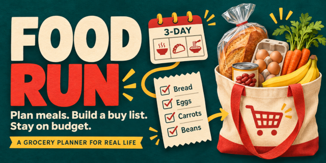

# Food Run



Food Run is a small browser app I built to get an idea of what to buy at the grocery store. Give it a spending limit, the kitchen equipment you have, and how much cooking you're willing to do, and it suggests meals, snacks, and drinks for the coming days, then builds a shopping list with an estimated total.

I'm sharing it for anyone who wants to customize it for themselves or play around with the idea.

## Prices are estimates

The starter prices are rough estimates of U.S. grocery prices as of **November 2026**. They aren't quotes from any store and will differ from what you pay. Enter your own prices on the **Prices** tab to make the plans match your store.

## Disclaimer

Food Run is a budgeting toy, not medical, nutritional, or dietary advice. It doesn't track nutrition, calories, allergens, or dietary restrictions, and it doesn't check whether a plan meets anyone's needs. The recipes include common allergens such as peanuts, tree nuts, milk, eggs, wheat, soy, and fish. Check ingredients yourself and follow the storage and cooking directions on each product's label. Raw flour and raw eggs aren't safe to eat, so don't taste raw dough or batter. Meat directions follow the [USDA safe internal temperatures](https://ask.fsis.usda.gov/article/What-is-a-safe-internal-temperature-for-cooking-meat-and-poultry).

The software is provided as is, without warranty of any kind. See [License](#license).

## Run it

There's no build step. From this folder, start any static web server, for example:

```sh
python3 -m http.server 8000 --bind 127.0.0.1
```

Then open <http://127.0.0.1:8000/>. Everything you enter is saved in your browser, on your computer only. Use **Backup** to export it.

## How the planner works

On the **Buy list** tab, set how many days to cover and your spending limit, then choose **Show what to buy**. Each day gets breakfast, lunch, dinner, three snacks, and a drink with each meal. The planner fits as many days as your limit allows, rounding up to whole packages.

Under **Food settings** you can adjust:

- **Equipment:** refrigerator, freezer, microwave, hotplate, and oven. Meals that need something you don't have are skipped.
- **I have the basics:** treats common spices, condiments, cooking oil, and sugar as already in your pantry.
- **Taste** and **Spice:** trade lower cost for meals you rate higher, and pick a heat level.
- **Preparation:** from **No prep** (ready to eat) through **Easy** (heat and eat) and **Cooking** to **Skilled** (from-scratch baking).
- **Variety:** how much to spread meals out. Variety costs money because groceries come in whole packages, so the planner only adds as much as fits your limit without covering fewer days.

A meal, snack, or drink never repeats on the same day or on back-to-back days. Morning coffee and evening tea are the exceptions and can appear every day.

When you shop, check items off a saved list and confirm what you bought to add it to **On hand**.

## Make it your own

The starter data is plain JSON in `data/`:

- `foods.json`: foods, their units, and whether they need refrigeration or cooking
- `prices.json`: a package size and price estimate for each food
- `meals.json`: meals, snacks, and drinks with ingredients, directions, and preparation level
- `example.json`: a small example dataset you can load from **Backup**

These files seed your browser the first time the app runs. After that, edits to the JSON won't replace what's already saved in that browser, so use a fresh browser profile to see your changes. You can also add and edit foods, prices, and meals inside the app.

The code is plain JavaScript in `src/`, loaded in order by `index.html`:

- `core/`: shared state, helpers, and meal slots
- `data/`: browser storage and starter data
- `planner/`: meal selection, cost estimates, and planner settings
- `meals/`, `products/`, `lists/`: the Meals tab, the product dialog, and saved buy lists
- `ui/`, `events/`: rendering and event handlers
- `sync/`, `backup/`: USB folder sync and JSON backups

## License

[MIT](LICENSE)
